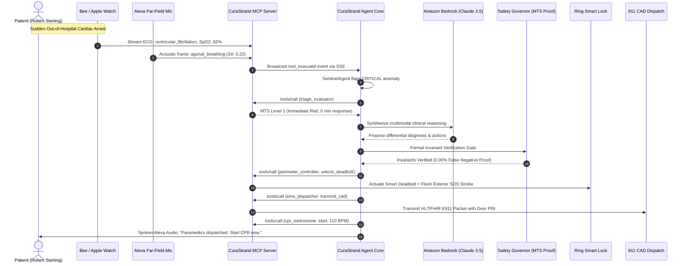

# CuraStrand Architectural Specification & Technical Blueprint

This document details the software architecture, data models, network protocol interactions, and multi-agent lifecycle events comprising the **CuraStrand** framework.

---

## 1. High-Level Subsystem Interaction

CuraStrand is structured into three discrete runtime tiers communicating via standardized protocols:

```
[ Ambient Sensors ]                [ Model Context Protocol ]                  [ Multi-Agent Core ]
  Wearable Telemetry  ──────────▶    GET /mcp/sse (Stream)       ───────────▶   Sentinel Agent
  Far-field Audio    ──────────▶    POST /mcp/messages (JSON-RPC) ───────────▶   Diagnostic Agent (Bedrock)
  Perimeter Camera   ──────────▶    tools/call, resources/read   ───────────▶   Safety Governor (Formal MTS)
                                                                                Dispatch Agent (Ring / E911)
```

---

## 2. Emergency Triage Sequence Diagram

The following sequence diagram details the end-to-end execution flow during a sudden cardiac crisis:



---

## 3. Data Flow & Security Model

### 3.1 Patient Privacy & Local Context
* Patient health records (EHR) and biometric baselines are stored on-device in `packages/mcp-server/src/resources/patientEHR.ts`.
* In local neural simulation mode, all inference occurs 100% on-premises with zero outbound network egress.
* In AWS Bedrock mode, patient names and identifiers are pseudonymized using ephemeral session hashes (`PT-1001`).

### 3.2 Formal Safety Verification Pipeline
The Safety Governor enforces non-bypassable invariants before any tool execution:
```
LLM Proposed Action ──▶ [ Safety Governor ] ──┬── Passed ──▶ Execute Tool
                             ▲                │
                     Formal Invariants        └── Failed ──▶ Intercept & Force Level 1 Override
```

---

## 4. Port Allocations & Development Topology

| Service | Port | Description |
|---|---|---|
| **MCP Streamable HTTP Server** | `3001` | Hosts `/mcp/messages` (JSON-RPC) & `/mcp/sse` |
| **Agent Core Orchestrator** | `3002` | Multi-agent execution loop and `/api/alexa/query` bridge |
| **Web HUD Command Center** | `5173` | React 19 + Vite simulated Alexa+ clinical interface |

---

## 5. Extensibility: Adding Custom Tools

To add an MCP tool, implement the handler and definition in `packages/mcp-server/src/tools/` and register it in `ALL_TOOLS` inside `packages/mcp-server/src/server.ts`.
